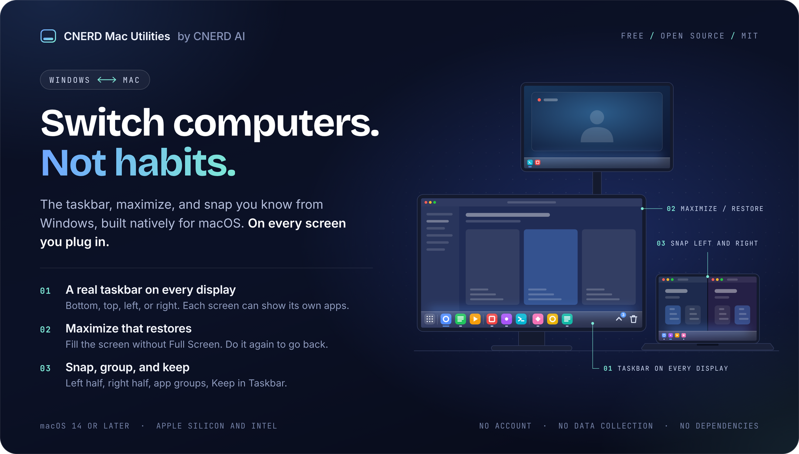

# CNERD Mac Utilities

<p align="center">
  
</p>

**Switch computers. Not habits.** If you work on Windows and on a Mac, you pay for it every time you change desks: no taskbar, a green button that goes Full Screen, and a Dock that lives on one screen at a time. CNERD Mac Utilities puts those Windows habits back, on every display you plug in.

Free, open source utilities that make a Mac feel familiar to people who come from Windows.
Native Swift, no dependencies, no account, no data collection. Developed by [CNERD AI](https://cnerd.ai).

If it saves you time, you can [support development with a donation](https://cnerd.ai/shop/?app=mac-utilities).

## Features

Every module has its own on and off switch. When a module is off it does nothing.

### Window Manager

- **Windows-style maximize.** Fills the usable screen without going into Full Screen. The menu bar stays in place, and the window stops at the Dock and at the taskbar.
- **Restore.** Maximize again and the window goes back to the size and place it had.
- **Snap.** Move a window to the left half, the right half, or the center of its display.
- **Multiple displays.** Every action stays on the display the window is on.
- **Global keyboard shortcuts.** They work from any app. The defaults are Control-Option with the arrow keys and C.
- **Your own shortcuts.** Record a new shortcut for each action, reset one, or restore the defaults. A shortcut that macOS already uses is refused.
- **Green window button (beta, off by default).** A click on the green button maximizes the window, and a second click restores it. Option-click still zooms. It works in apps that use the standard window buttons.
- **Menu bar commands.** Maximize, left, right, and center are also in the menu bar icon's menu.

### Taskbar & Dock

**The taskbar**

- **A Windows-style taskbar** on all displays, on the main display only, or on the other displays only.
- **Any edge.** Bottom, top, left, or right. This is separate from the Dock's position.
- **Drag it to another edge.** Press and hold an empty part of the taskbar and drag toward the left, right, top, or bottom of the screen. An outline shows where it will land. Let go to move it.
- **Look.** Square edges that run edge to edge like Windows, or rounded edges that float like the Dock. Glass or solid background.
- **Icon size.** A slider from 16 to 72 points. The taskbar follows as you drag.
- **App names.** On or off, in four sizes, placed right of, left of, above, or below the icon.
- **Running apps.** The taskbar shows the apps that are open, marks the app in front, and updates as apps open and quit.
- **Click to switch.** Click an app to bring it forward. Click the app in front to hide it.
- **Drag to reorder.** The order is saved.
- **Keep in Taskbar.** A kept app stays on the taskbar when it is not running, and a click opens it.
- **Auto-fit.** When the apps do not fit, the taskbar hides the names, then shrinks the icons, then puts the rest behind a "+N" button. A click on that button opens a pop-up with the apps that did not fit.
- **Right-click the taskbar.** A right-click on any empty part of the taskbar, or on the Applications button, gives Add Icons, Add from Apple Dock, Position on Screen, Taskbar & Dock Settings, App Icon Controls, and Switch to Apple Dock.
- **Add Icons.** Pick apps in a file chooser and they stay on the taskbar.
- **Add from Apple Dock.** Lists the apps kept in the Apple Dock that the taskbar does not have yet. Add one, or all of them at once.
- **Drop apps from Finder.** Drag an app from the Applications folder, or from any Finder window, onto the taskbar. Drop it between two apps to put it there.
- **Applications button.** A click opens the Applications folder.
- **Trash.** A click opens the Trash. A right-click gives Open, Empty Trash (it asks first), and Eject for each disk or all of them. The Trash can be turned off.
- **Keep Windows Clear of the Taskbar.** Maximize and snap stop at the taskbar's edge.
- **Follows the Dock.** When the Dock is hidden, the taskbar slides into the Dock's space. The taskbar steps aside for apps in Full Screen.

**More than one display**

- **Show Apps On.** Every taskbar can show every app (All Taskbars), or each taskbar can show the apps that have a window on its display (Main Taskbar and Where the Window Is, or Only Where the Window Is).
- **Apps chosen per display.** Set a display to Only Apps I Choose and its taskbar shows just those apps, in your order, running or not. Good for a small screen that has one job.
- **Buttons per display.** A switch shows or hides the Applications, Hidden Apps, and Trash buttons on a chosen-apps taskbar.
- **Remembered per display.** The choices come back after a restart and after a display is unplugged and plugged in again.
- **Fitted per display.** A small screen can shrink its icons while a large one does not.

**App groups and App Icon Controls**

- **Group Apps.** Related apps sit side by side with a line between groups.
- **Sorted by topic.** AI Tools, Browsers, Communication, Productivity, Developer Tools, Design & Media, Games, System & Utilities, and Other. New apps can be sorted as they are first opened, and Group by Topic sorts everything again.
- **Your own groups.** Make, rename, delete, and reorder groups. Drag apps inside a group or into another one.
- **App Icon Controls screen.** One place for the icon size, the groups, the hidden apps, and the apps for each display. Add App puts any app on the taskbar.

**Hidden apps**

- **Hide from Taskbar.** Moves a running app off the bar and behind the Hidden Apps button. The app keeps running.
- **Hidden Apps button.** Shows how many hidden apps are running. A click opens a pop-up next to the taskbar, where the apps work the same as on the bar.
- **Bring them back.** Show in Taskbar for one app, or Show All in Taskbar for all of them. Apps can also be dragged in and out.
- **Four button pictures.** Sunglasses, Stack, Eye, or Drawer.

**Right-click an app**

- Open, Show All Windows, Hide, and Quit
- Keep in Taskbar and Remove from Taskbar
- Hide from Taskbar and Show in Taskbar
- Move to Group
- Show on Display and Remove from This Display
- Show in Finder

**The Apple Dock**

- **One switch** goes between this taskbar and the Apple Dock, and back. It is in the Applications button's menu, in Taskbar & Dock settings, in the menu bar icon's menu, and in this app's Dock icon menu.
- **Dock switches.** Auto-hide, position (left, bottom, or right), and size.
- **Turn Off the macOS Dock.** Keeps the Dock from sliding back in while the taskbar is in use. The app asks first, and one switch brings the Dock back. The Dock also comes back by itself when the app quits, and goes off again the next time the app opens.

### Finder Enhancements

- **Show Hidden Files.** The app asks before it restarts Finder.
- **Copy Selected File Path.** Copies the full path of the files or folders selected in Finder. Also in the menu bar icon's menu.
- **Quick Access Folders.** Home, Documents, Downloads, Desktop, and Applications.

### Desktop Manager

- **Display information.** Every connected display with its name, resolution, available desktop area, and which one is primary. The list updates when a display is plugged in or unplugged.
- **Desktop file list.** Sort by name, type, or date modified, refresh, and open the folder or an item in Finder. The list is read-only. The app never moves, renames, or deletes your files.
- **Desktop icons.** A button opens the macOS Desktop & Dock setting that shows or hides them.

### The app itself

- **Dashboard.** Every utility with its on and off state, the Accessibility permission, Launch at Login, and the version.
- **Menu bar icon.** Window commands, Copy Finder Selection Path, the taskbar and Apple Dock switch, Open, Donate, and Quit. The icon can be turned off.
- **Launch at Login.**
- **Light and dark.** Follows your macOS setting.
- **Permissions in one place.** General Settings shows each permission, whether it is granted, and a button to grant it. The app asks only when a feature needs it.
- **Stays out of the way.** Closing the window does not quit the app.
- **Version and build number** in the sidebar, the Dashboard, and General Settings.
- **Private.** No account, no data collection, and no network connections.
- **Free and open source.** MIT license, no dependencies. A Donate menu for anyone who wants to help, and an I Have Donated switch on the honor system.
- **Signed and notarized by Apple.** One download for Apple silicon and Intel.

Limits and test notes for each feature are in [docs/FEASIBILITY.md](docs/FEASIBILITY.md).

## Requirements

- macOS 14 or later, Apple silicon or Intel
- To build: Xcode 16 or later and [XcodeGen](https://github.com/yonaskolb/XcodeGen) (`brew install xcodegen`)

## Install

**Download:** get the `.dmg` from the [latest release](https://github.com/CNERDAI/cnerd-mac-utilities/releases/latest). It is signed and notarized by Apple. Open the `.dmg` and drag the app to Applications.

**Build it yourself:**

```bash
git clone https://github.com/CNERDAI/cnerd-mac-utilities.git
cd cnerd-mac-utilities
./build.sh
open "build/Build/Products/Debug/CNERD Mac Utilities.app"
```

## First run

1. Open the app, go to **Window Manager**, and click **Request Access**. Turn on CNERD Mac Utilities under System Settings, Privacy & Security, Accessibility. macOS requires this before any app can move another app's windows.
2. Try the shortcuts in any app:

| Action | Default shortcut |
| --- | --- |
| Maximize / Restore | Control-Option-Up |
| Move window left | Control-Option-Left |
| Move window right | Control-Option-Right |
| Center window | Control-Option-C |

3. Open **Taskbar & Dock** and turn on **Show Taskbar**.

Closing the window does not quit the app. Use the menu bar icon to reopen it or quit.

## Removing the app

1. If you turned the Dock off, switch **Turn Off the macOS Dock** off again, or just quit the app. Quitting brings the Dock back.
2. Quit the app from the menu bar icon and drag it from Applications to the Trash.
3. Optional: remove its saved settings with `defaults delete ai.cnerd.MacUtilities`.

If the app ever stops without bringing the Dock back (a crash or a forced quit), this puts the Dock back by hand:

```bash
defaults delete com.apple.dock autohide-delay
defaults write com.apple.dock autohide -bool false
killall Dock
```

## Permissions

The app asks for a permission only when a feature needs it.

| Permission | Used for | When macOS asks |
| --- | --- | --- |
| Accessibility | Moving and resizing other apps' windows, the green button option | When you click Request Access |
| Automation: Finder | Reading which files are selected, to copy their paths. Emptying the Trash from the taskbar. | First use of Copy Path or Empty Trash |
| Automation: System Events | Changing Dock auto-hide, position, and size | First use of a Dock switch |
| Desktop folder | Listing the files on your Desktop | First time you open Desktop Manager |

The app makes no network connections. The Donate buttons open a web page in your browser.

## How it works, and what macOS does not allow

macOS does not let apps change everything Windows users might expect. [docs/FEASIBILITY.md](docs/FEASIBILITY.md) lists, feature by feature, which public API is used, what the limits are, and where the app relies on behavior Apple does not document. A few to know up front:

- The app cannot be sandboxed, so it cannot be sold in the Mac App Store. Window control of other apps needs the Accessibility API.
- macOS shows the real Dock on one display at a time. The taskbar is this app's own bar, and only this app's maximize and snap know to stay clear of it.
- Turning the Dock off uses an undocumented Dock setting. The app asks before doing it, and one switch brings the Dock back.
- macOS does not hand a Dock icon to another app when you drag it out of the Dock. It only offers to remove it. So the taskbar has Add from Apple Dock in its right-click menu, and takes apps dragged from Finder.

## Building and testing

```bash
./build.sh          # generate the Xcode project and build a Debug app into ./build
./build.sh test     # run the unit tests
xcodegen generate   # regenerate the Xcode project, then open CNERDMacUtilities.xcodeproj
```

`project.yml` is the source of truth for the Xcode project. Run `xcodegen generate` after adding, moving, or deleting files.

## Versions and releases

The version lives in one file, `Config/Version.xcconfig`, and is changed with `./version.sh`:

```bash
./version.sh          # show the version and build number, for example 1.1.0 (12)
./version.sh patch    # 1.1.0 -> 1.1.1   fixes
./version.sh minor    # 1.1.0 -> 1.2.0   new features
./version.sh major    # 1.1.0 -> 2.0.0   big changes
```

- **The build number goes up on every build.** `./build.sh` raises it by one, so the app always shows which build is running. The sidebar and the Dashboard show it as `1.1.0 (12)`.
- **Every release gets a new version.** `./release.sh` stops if the version already has a release tag.
- **Every release is written down** in [CHANGELOG.md](CHANGELOG.md).

To make a release: raise the version, add its section to `CHANGELOG.md`, commit, run `./release.sh`, then tag the commit `v<version>` and publish the `.dmg`.

**Signing.** By default the app is signed to run locally, which needs no Apple developer account. macOS forgets the Accessibility permission each time an ad-hoc signed app is rebuilt. To avoid that, create `Config/Signing.local.xcconfig` with your own certificate. See the comments in `Config/Signing.xcconfig`.

**Releases.** `./release.sh` builds a universal Release app, signs it with a Developer ID certificate, makes the `.dmg`, and can notarize it. See the comments at the top of the script.

## Project layout

```
project.yml                     XcodeGen project definition
Config/                         Version, signing settings, generated Info.plist and entitlements
CNERDMacUtilities/
  App/                          App entry point and app delegate
  Core/                         Settings store, environment, shared types
  Models/                       Plain data types and pure layout and ordering rules
  Services/                     Permissions, login item, global hot keys, Dock facts, window locations
  Modules/
    WindowManager/              Accessibility window control, geometry, green button tap
    Taskbar/                    Taskbar panels, running apps, Dock settings
    FinderEnhancements/         Finder preferences, selection path, folders
    DesktopManager/             Desktop file list, displays
  Views/                        SwiftUI screens, one per module, plus shared components
  Resources/                    Asset catalog, including the app icon
CNERDMacUtilitiesTests/         Unit tests
docs/                           FEASIBILITY.md, ARCHITECTURE.md, and images for this page
CHANGELOG.md                    What changed in each release
version.sh                      Shows or raises the version
Artwork/                        Icon source artwork
```

More detail is in [docs/ARCHITECTURE.md](docs/ARCHITECTURE.md).

## Contributing

Issues and pull requests are welcome. Please read [CONTRIBUTING.md](CONTRIBUTING.md) first. The short version: public APIs only, no dependencies, every module can be switched off, and anything that leans on undocumented behavior is written down in `docs/FEASIBILITY.md`.

## Support development

CNERD Mac Utilities is free. If you want to help pay for the time that goes into it, the **Donate** button at the bottom of the app's sidebar offers $5, $10, $20, $50, and $100, or use the [CNERD shop](https://cnerd.ai/shop/?app=mac-utilities). Thank you.

After you donate, you can turn on **I Have Donated** in General Settings. It swaps the Donate button for a thank-you. It is on the honor system: nothing is checked, and nothing is locked either way.

## License

[MIT](LICENSE). Copyright (c) 2026 CNERD AI.

## Names, logos, and trademarks

The MIT license covers the source code. The CNERD AI and CNERD Mac Utilities names, logos, and app icon are trademarks of CNERD AI and are not part of that license. If you share a changed version, please give it your own name and icon.

CNERD Mac Utilities is not affiliated with, endorsed by, or sponsored by Apple Inc. or Microsoft Corporation. Mac, macOS, Finder, and Dock are trademarks of Apple Inc. Windows is a trademark of Microsoft Corporation. All other names, logos, and app icons belong to their owners, and are mentioned with respect, only to describe what this app works with.

The full note is in [TRADEMARKS.md](TRADEMARKS.md).
